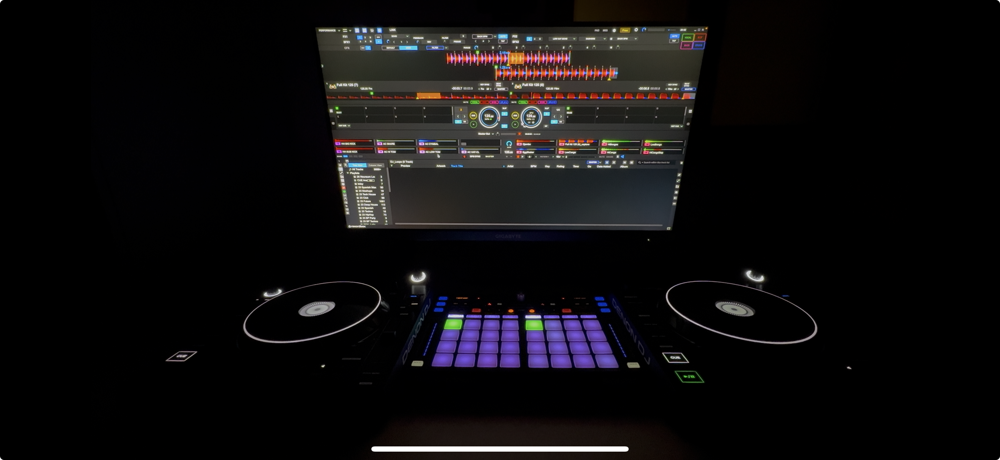
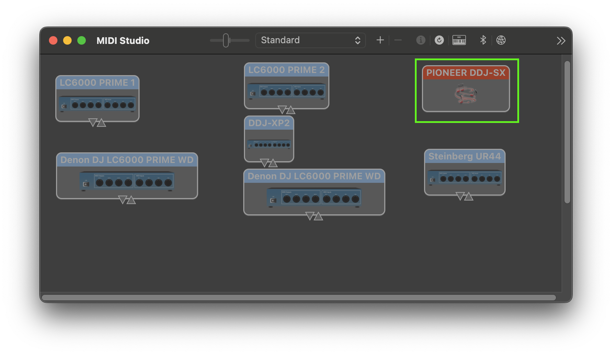
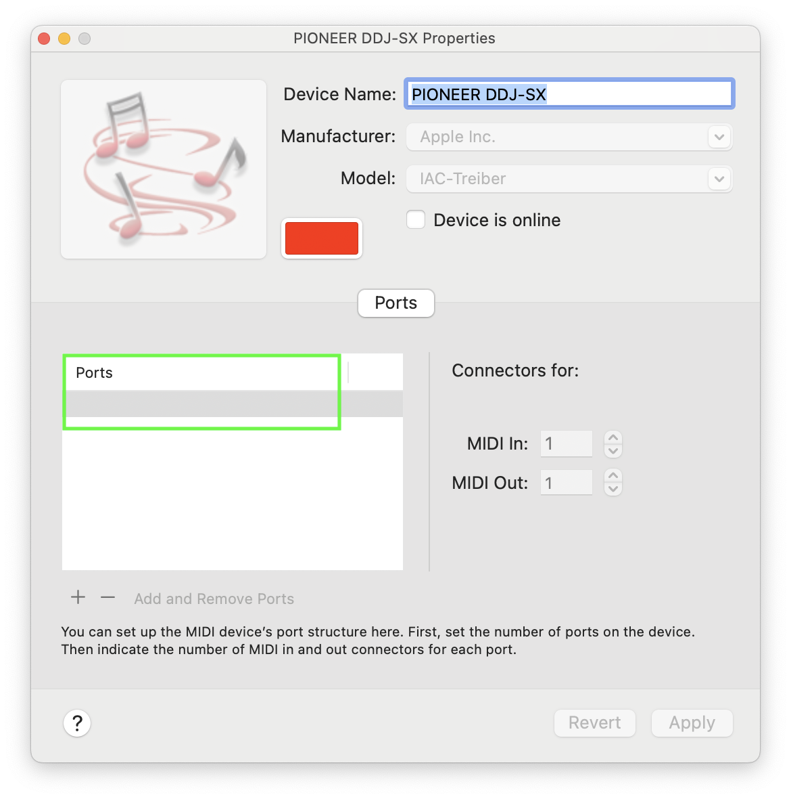
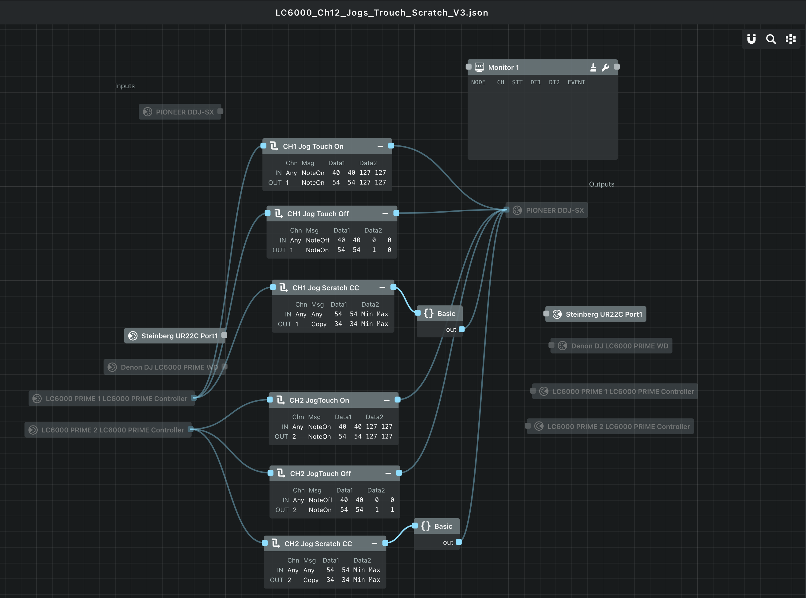

# Motivation

This guide explains how to use Denon LC6000 PRIME controllers in rekordbox Performance mode on macOS.

After stumbling across [this article from 2017](https://djtechtools.com/2017/05/08/hack-rekordbox-use-controllers-jogwheels/), I wondered whether this hack still worked today and whether it would work with Denon LC6000 controllers. The answer to both questions is yes. This guide walks you through the setup.

**Disclaimer:** This started as a feasibility study. The end result is a functional combination of Denon hardware and rekordbox software that proved surprisingly stable in my testing.

> [!CAUTION]
> This setup is experimental and provided as is, without any guarantees or warranties of any kind. It has only been tested under the specific hardware and software configurations described in this guide. Your results may vary.
> 
> Follow these instructions at your own risk. I accept no responsibility for any damage to hardware, software, data loss, unexpected behaviour, or other issues arising from the use of this setup. Always back up your configurations and mappings before making changes.
> By following this guide, you acknowledge that you do so entirely at your own risk.

# Guide

## 1. Prerequisites

1. Enable MIDI mapping in rekordbox v7 Performance mode through either:
   - a hardware unlock, or
   - a subscription plan that includes MIDI mapping.

   > This is required to map all controls except the jogwheels.

2. Install [Mididash](https://github.com/tiagolr/mididash).

   > Mididash is required to map the jogwheels.

## 2. Supported controls

**Via the spoofed controller:**

- Jog platter touch
- Jog scratch (forward/reverse)

**Via regular MIDI mapping:**

- Play
- Cue
- Beat Jump
- Track Skip
- Slip Reverse
- Loop encoder (push to activate/deactivate; turn to change the loop size)
- Loop in/out buttons
- Needle Drop
- Browse knob, Back and Forward buttons
- Vinyl, Sync, Master Tempo and Key Reset
- Pitch fader
- Pitch Bend buttons
- Slip and Quantize (mapped to Denon LC6000 left/right arrow buttons)
- ~~Hot Cues~~ (see [Hot cues](#hot-cues))
- ~~Pad modes~~ (see [Pad modes](#pad-modes))

Lighting is also supported through MIDI Out messages.

## 3. Spoof a DDJ controller

1. Open macOS's built-in `Audio MIDI Setup`.
2. Find the device called `IAC Driver`.
3. Rename the IAC Driver to `Pioneer DDJ-SX`. The name must exactly match an official device name used by rekordbox. Use the same name as the stock mapping files. On macOS, these mappings are located at:

   `/Applications/rekordbox 7/rekordbox.app/Contents/Resources/MidiMappings`

   

4. Make sure to remove the bus name:

   

   Whatever name appears here is appended to the device name that rekordbox reads. For example, `Pioneer DDJ-SX Bus 1` is not recognized by rekordbox as the controller.

5. Do not enable the `Device is online` checkbox yet. rekordbox must be started first.

**Notes**

1. The spoofed DDJ-SX will only be detected **after** MIDI mapping is available (see [Prerequisites](#1-prerequisites)).
2. Spoofing does not seem to work with rekordbox-native devices such as the `Pioneer DDJ-RX`. I suspect this is related to the way hardware unlock is implemented.

## 4. Connect the spoofed controller

1. Start rekordbox and make sure MIDI mapping is available.
2. Enable the spoofed DDJ-SX by selecting the `Device is online` checkbox.
3. If the connection works, rekordbox will acknowledge it in the status bar at the bottom of the screen.
4. Once connected, rekordbox may briefly glitch, with random MIDI messages being triggered. You can stop this by loading an almost empty MIDI mapping for the spoofed DDJ-SX.
5. Open the MIDI mapping settings and load `rekordbox/empty_mapping.midi.csv` for the spoofed `Pioneer DDJ-SX` device. This removes the existing MIDI configuration; you will add the Denon mappings in the next section.

**Notes**

A completely empty `midi.csv` mapping file will silently restore the default mapping.

## 5. Connect the Denon LC6000 controllers

rekordbox cannot detect multiple devices with the same name.

1. Open macOS's built-in `Audio MIDI Setup`.
2. Give each Denon device a unique name. For example, use `LC6000 PRIME 1` for Deck 1 and `LC6000 PRIME 2` for Deck 2.

### 5.1 MIDI mapping

1. Load the MIDI mapping `rekordbox/LC6000_CH1.csv` for Deck 1.
2. Load the MIDI mapping `rekordbox/LC6000_CH2.csv` for Deck 2.

**Notes**

1. The MIDI mapping page in rekordbox uses hexadecimal notation:
   - `90` = Note On
   - `80` = Note Off
   - `B0` = Control Change (continuous controller)
2. Mapping buttons requires both `NoteOn` (for example, `9020`) and `NoteOff` (for example, `8020`) entries. In other words, you need two entries in the MIDI mapping for every physical button. This does not apply to knobs, encoders and the needle drop touchpad.

### 5.2 Jogwheel mapping via Mididash

1. Start the Mididash app.
2. Load the mapping file `mididash/LC6000_Ch12_Jogs_Trouch_Scratch.json`.
3. Make sure all connections are set up as shown in the overview above. Disconnected devices are greyed out; replace them as required for your setup.
4. Make sure Mididash is running by pressing the Play/Pause button in its toolbar.
5. When you press buttons or touch and scratch the jogwheel, you should see messages propagating along the edges in the graph view.

**Notes**

1. The MIDI **channel** (`Chn` in Mididash) corresponds to the deck on the spoofed DDJ-SX. This is just a coincidence specific to this controller.
2. Regardless of the deck selection (Shift + Slip), the Denon LC6000 sends the same MIDI messages on Channel 1. That is why we need to remap the messages explicitly to MIDI Channels 1 and 2 in the Mididash remap blocks.
3. Extending the setup to more than two Denon LC6000 controllers should be possible; see [Extension to four Denon LC6000 controllers](#extension-to-four-denon-lc6000-controllers).

#### Jog touch

For each Denon LC6000, add:

- One remap block named `Jog Touch On`, which remaps the message to `NoteOn 54 127`.
- One remap block named `Jog Touch Off`, which remaps the message to `NoteOn 54 1`. Counterintuitively, we must send `NoteOn` here, despite what the official MIDI mappings might lead you to expect.

**Notes**

1. Be careful not to confuse decimal and hexadecimal notation. Mididash displays decimal `Data1` and `Data2` values in remap blocks, while rekordbox displays MIDI messages in hexadecimal.
2. The *Monitor* window helps you understand which messages are being sent by the Denon LC6000.

#### Jog scratch

For each Denon LC6000, add the following blocks:

- **Jog Scratch CC:** Remaps the MIDI message to Channel 1 or 2 (for Deck 1 or 2) and sets `Data2` to `34`.
- **{} Basic:** This Lua script remaps the scratch logic. Getting this mapping right was the hardest part of the project because Pioneer and Denon use the available MIDI `Data2` ranges in completely different ways. Both the forward/reverse direction and the speed range (slow-to-fast versus fast-to-slow) are inverted.

  The Lua source is included as a separate file at `mididash/lc6000_jog_remap.lua`, so you can inspect it without opening Mididash.

## 6. Open questions and possible extensions

### Extension to four Denon LC6000 controllers

**Disclaimer:** I have only tested this setup with two Denon LC6000 controllers.

**Hypothesis:** Extending the setup to four decks should be possible because the DDJ-SX supports four decks natively.

1. Extend the Mididash mapping for each additional deck (see [Jogwheel mapping via Mididash](#52-jogwheel-mapping-via-mididash)).
2. Repeat the MIDI mapping process for each additional deck (see [MIDI mapping](#51-midi-mapping)).

### Denon LC6000 + DJM mixer

**Hypothesis:** Combining LC6000 controllers with DJM mixers should be possible. Based on my research, it is possible to connect a DJM mixer in addition to a DDJ controller. Connecting a DJM mixer will deactivate the mixer section of the spoofed DDJ controller which does not exist physically anyway.

### Denon LC6000 + real DDJ controller

I have not tested combining Denon LC6000 controllers with real (non-spoofed) DDJ controllers.

**Hypothesis:** Combining LC6000 controllers with four-channel DDJ controllers, such as the DDJ-FLX10, should be possible. This would provide physical control of Decks 3 and 4 without relying on the deck-select buttons.

In this setup, skip the [DDJ controller spoofing](#3-spoof-a-ddj-controller). Instead, go directly to [jogwheel mapping via Mididash](#52-jogwheel-mapping-via-mididash) and [MIDI mapping](#51-midi-mapping) for the remaining buttons.

**Notes**

rekordbox only detects one device from each device category (DDJ/DJM), with the exception of the DDJ-XP2 sub-controller, which can be used alongside another DDJ controller.

## 7. Limitations

### SHIFT behaviour

The way SHIFT works differs between controllers. On Pioneer controllers, pressing SHIFT changes the MIDI codes sent by the hardware. On the Denon LC6000, SHIFT acts as a modifier: it is sent in addition to the original, unchanged MIDI message.

rekordbox does not support this kind of modifier in its MIDI mapping system. This affects hotcues and pad modes, as explained below.

#### Hot Cues

I initially mapped the hot cues using rekordbox's MIDI mapping. This worked, but I ran into a few limitations:

1. **RGB lighting:** A simple MIDI Out mapping for hotcues will only light the LEDs in white. This is limiting compared with native DDJ controllers. RGB support would require remapping the MIDI `Data2` value to account for the differences between Pioneer and Denon's RGB colour interpretations.
2. **Modifiers:** Mapping functions such as `SHIFT + HOTCUE 1` (to delete hot cue 1, for example) is only possible by implementing the modifier logic in Mididash. I have not explored this yet.
3. **Interference:** I noticed some interference between the hot cues mapped to the spoofed DDJ-SX (with its empty mapping) and the connected DDJ-XP2. For example, I could not activate pad modes 1–8 using either the XP2 or the rekordbox UI.

#### Pad modes

The lack of modifier logic also affects pad modes. It is possible to map the `HOTCUE`, `LOOP`, `SLICER` and `ROLL` pad modes on the Denon LC6000 to their corresponding modes in rekordbox. The UI switches the pad modes on screen, but the MIDI codes sent by each hot cue button remain unchanged. Solving this would require stateful modifier logic in Mididash.

## 8. Test coverage

I initially tested this with rekordbox version `5.8.6`, which allows MIDI mapping without a hardware unlock device or subscription.

The final test was performed with rekordbox version `7.2.14.0323` on macOS Sequoia `15.7.3`, using a DDJ-XP2 for hardware unlock and two Denon LC6000 controllers.

# References

- [DJ TechTools: Hack rekordbox to use controllers and jogwheels](https://djtechtools.com/2017/05/08/hack-rekordbox-use-controllers-jogwheels/)
- [Denon LC6000 PRIME MIDI Specification v1.0](https://cdn.inmusicbrands.com/denondj/lc6000/LC6000-PRIME-MIDI-Specification-v1.0.pdf)
- [DDJ-SX1 MIDI messages](https://github.com/pestrela/ddj/blob/main/1%20MIDI%20codes/DDJ-SX1%20-%20MIDI_Messages.pdf)
- [Mididash](https://github.com/tiagolr/mididash)
- [RekordJog](https://github.com/timkondratev/RekordJog)
